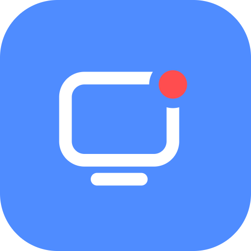

<div align="center">



<h1>LiveOn</h1>

<p>Compartilhamento de tela com áudio do sistema para um grupo pequeno de amigos.<br/>
App desktop para Windows, com vídeo e som indo direto de um computador para o outro.</p>

<p>
  <a href="https://github.com/gabrielfernandesdelara/LiveOn/releases/latest"><strong>Baixar a última versão</strong></a>
  ·
  <a href="https://github.com/gabrielfernandesdelara/LiveOn/issues/new">Reportar um bug</a>
  ·
  <a href="https://github.com/gabrielfernandesdelara/LiveOn/issues/new">Sugerir uma funcionalidade</a>
</p>

<p>
  
  
  
  
</p>

</div>

---

<details>
  <summary><strong>Sumário</strong></summary>

- [Sobre o projeto](#sobre-o-projeto)
- [Funcionalidades](#funcionalidades)
- [Privacidade e segurança](#privacidade-e-segurança)
- [Tecnologias](#tecnologias)
- [Como rodar localmente](#como-rodar-localmente)
- [Gerando e publicando](#gerando-e-publicando)
- [Estrutura de pastas](#estrutura-de-pastas)
- [Roadmap](#roadmap)
- [Autor](#autor)

</details>

## Sobre o projeto

<!-- Salve um print em assets/images/readme/screenshot.png e descomente:
<div align="center">
  
  <p><sub><em>Sala com telas compartilhadas. O layout pode sofrer alterações.</em></sub></p>
</div>
-->

O LiveOn nasceu para um grupo de amigos assistir à tela uns dos outros com o
som do jogo ou do vídeo junto, sem depender de bot do Discord nem de navegador.
Uma pessoa cria a sala, manda o código para os outros, e cada um escolhe se
quer transmitir um monitor ou uma janela.

Por baixo, cada par de pessoas tem a sua própria conexão WebRTC (malha P2P):
a imagem e o som vão direto de um computador para o outro, cifrados de ponta a
ponta. O único servidor é o de sinalização, um Worker da Cloudflare que apenas
apresenta as pessoas da sala umas às outras e nunca vê vídeo nem áudio. Para
o tamanho do grupo, por volta de **5 pessoas**, a malha dispensa servidor de
mídia.

## Funcionalidades

- **Salas por código**: o código tem **12 caracteres sorteados** (~59 bits) e é a única chave da sala. Não existe lista de salas abertas.
- **Monitor ou janela**, escolhidos numa grade de miniaturas própria do app.
- **Áudio do sistema sem eco**: um addon nativo captura o som por processo, então dá para transmitir **tudo menos o Discord** (a voz dos amigos não volta para eles) ou **só o áudio da janela** compartilhada.
- **Qualidade de 360p a 1440p**, em **30 ou 60 fps**, com teto de bitrate de **~0,7 a ~13,5 Mbps** acompanhando a escolha.
- **Cada um escolhe o que recebe**: quem assiste pode pedir menos resolução ou fps só para si, sem mudar o que a pessoa transmite nem o que os outros recebem.
- **Ajustar a transmissão no ar**: trocar de tela, resolução ou fps sem parar de transmitir.
- **Grade calculada**: as telas se redimensionam para caber, sempre em 16:9, com duplo clique para destacar, modo expandido e tela cheia.
- **Volume por pessoa** e escolha da **saída de áudio** (fone, caixa ou outro aparelho).
- **Reconexão automática**: se a conexão com o servidor cai, o app tenta voltar por **105 segundos** e quem volta continua sendo a mesma pessoa, sem derrubar o vídeo. A sala vazia fica de pé por **2 minutos** esperando.
- **Atualização automática**: o app baixa a versão nova em segundo plano e instala ao reiniciar, sem assistente.
- **Prioridade alta** de processo, para a transmissão não engasgar quando um jogo disputa a CPU.

## Privacidade e segurança

Vale ler antes de usar:

- **Quem está na sala vê o seu IP.** Para a mídia ir direto entre os computadores, cada um precisa saber o endereço dos outros. Só entre em sala de quem você conhece e não passe o código adiante.
- **O código não se troca** e não existe expulsar alguém. Para tirar uma pessoa, crie uma sala nova.
- **O servidor vê** seu IP, o nome que você escolheu, o código e quando você entra e sai. **Não vê** vídeo nem áudio, e nada disso fica guardado depois que a sala fecha.
- **No seu computador** ficam o nome, as preferências e um log em `%APPDATA%\liveon\liveon.log`. O código da sala sai mascarado nele, então mandar o log para alguém não entrega a entrada da sala.

Do lado da proteção: tentativas de código limitadas a 20 por minuto por IP,
limite de tamanho e de ritmo de mensagens dentro da sala, CSP estrita, janela
isolada (`contextIsolation` e `sandbox`) que nunca navega para fora do app, e
executável com as fuses do Electron fechadas.

Falhas de segurança se reportam em particular, como explica o [SECURITY.md](SECURITY.md).

## Tecnologias

<p>
  
  
  
  
  
  
  
</p>

| Tecnologia | Uso |
|---|---|
| Electron | App desktop, captura de tela e áudio do sistema (`audio: 'loopback'`) |
| HTML, CSS e JavaScript puros | Interface, sem framework e sem etapa de build |
| WebRTC | Vídeo e áudio P2P entre cada par de pessoas, com teto de qualidade por par |
| Cloudflare Workers e Durable Objects | Sinalização: uma sala por código, com hibernação para caber no plano gratuito |
| C++ (WASAPI) | Addon nativo que captura o áudio de um processo, ou de todos menos um |
| electron-builder e electron-updater | Instalador de um clique e atualização automática pelo GitHub Releases |

## Como rodar localmente

Pré-requisitos: **Windows 10 versão 2004 ou mais novo**, **Node.js** e, para o
áudio por processo, o **Visual Studio Build Tools** com C++.

```bash
# 1. Clone o repositório
git clone https://github.com/gabrielfernandesdelara/LiveOn.git

# 2. Entre na pasta
cd LiveOn

# 3. Instale as dependências
npm install

# 4. Abra o app
npm start
```

### Addon de áudio (opcional)

Sem ele o app funciona, mas só oferece *todo o áudio do sistema* ou *sem
áudio*. Para compilar:

```bash
winget install Microsoft.VisualStudio.2022.BuildTools --override "--wait --passive --add Microsoft.VisualStudio.Workload.VCTools --includeRecommended"
```

```bash
npm run nativo:compilar
```

O script compila para a versão do Electron do projeto. Ao atualizar o
Electron, ajuste o `--target` dele e compile de novo.

### Sinalização própria (para forks)

O app conecta na sinalização do projeto. Para usar a sua, publique o Worker
numa conta da Cloudflare:

```bash
npx wrangler login
```

```bash
npm run nuvem:publicar
```

Depois troque o endereço em **dois lugares**, que precisam andar juntos: a
constante `SERVIDOR` em `app/js/configuracao.js` e o `connect-src` da CSP no
topo do `app/index.html`. Trocando só o primeiro, o app para de conectar sem
mensagem de erro. Para testar o Worker sem publicar: `npm run nuvem`.

## Gerando e publicando

```bash
npm run empacotar
```

Gera em `dist/` o `LiveOn-<versão>-instalador.exe`: instala na pasta do usuário
sem pedir administrador, cria os atalhos e abre o app. O fim do comando apaga
os instaladores de versões anteriores.

Para publicar uma versão que os apps instalados recebam sozinhos:

```bash
$env:GH_TOKEN="<token com Contents: Read and write no repositório>"
npm run publicar
```

O repositório de releases precisa ser **público**: privado, o atualizador
exigiria um token dentro do app. Para conferir o que os apps estão enxergando:

```bash
curl -sL https://github.com/gabrielfernandesdelara/LiveOn/releases/latest/download/latest.yml
```

O instalador não é assinado, então o Windows mostra o aviso do SmartScreen na
primeira vez. Para seguir: **Mais informações** e depois **Executar assim
mesmo**. Só baixe o LiveOn dos [releases deste repositório](https://github.com/gabrielfernandesdelara/LiveOn/releases).

## Estrutura de pastas

```
LiveOn/
├── app/
│   ├── main.js            # Processo principal: janela, IPC, captura e atualização
│   ├── preload.js         # Ponte entre a interface e o processo principal
│   ├── index.html         # Estrutura da tela e a CSP
│   ├── estilo.css         # Toda a aparência, com os temas de cores
│   ├── fontes/            # Sora, só para o logotipo (licença OFL)
│   └── js/                # O cliente, um arquivo por assunto, em ordem de carga
│       ├── configuracao.js  # ICE, bitrate, endereço do servidor, sorteio do código
│       ├── sinalizacao.js   # Conversa com o servidor da sala e reconexão
│       ├── malha.js         # Uma conexão WebRTC por par e o teto de qualidade
│       ├── audio-nativo.js  # Áudio por processo, do addon até virar trilha
│       ├── transmissao.js   # Começar, ajustar no ar e parar
│       ├── seletor.js       # Escolha de tela ou janela, qualidade e áudio
│       ├── grade.js         # Os cards e o cálculo do tamanho deles
│       └── ...              # Destaque, som, ajustes, pessoas, ícones, tema
├── nuvem/
│   ├── src/worker.js      # Sinalização: Worker + Durable Object, uma sala por código
│   └── wrangler.toml      # Configuração do Worker e do limite de tentativas
├── nativo/
│   ├── src/               # Addon C++ de captura de áudio por processo
│   └── indice.js          # Carrega o addon; se não estiver compilado, o app segue sem
├── scripts/
│   └── limpar-dist.js     # Apaga de dist/ os instaladores de versões antigas
├── build/
│   └── icon.png           # Ícone do app (512x512)
├── SECURITY.md            # Como reportar falhas e o que o app protege
└── package.json
```

## Roadmap

- [x] Sala por código sorteado, com sinalização na Cloudflare
- [x] Monitor ou janela, com áudio do sistema
- [x] Áudio por processo (tudo menos o Discord, ou só a janela)
- [x] Qualidade escolhida por quem assiste
- [x] Ajustar a transmissão sem parar
- [x] Reconexão que preserva a pessoa e o vídeo
- [x] Instalador de um clique e atualização automática
- [x] Redesign da interface
- [ ] Servidor TURN, para quem está atrás de NAT simétrico conseguir conectar e para não expor o IP
- [ ] Mostrar a qualidade e o bitrate que estão chegando de cada pessoa
- [ ] Escolha de tema de cores na interface (as paletas já existem)

## Autor

<p>
  Desenvolvido por <strong>Gabriel Fernandes de Lara</strong>
</p>

<p>
  <a href="https://www.linkedin.com/in/gabrielfernandesdelara/"></a>
  <a href="https://github.com/gabrielfernandesdelara"></a>
</p>
